<div align="center">


# StorageLens

### Make sense of everything on your PC.

A free Windows app that maps your drives and explains what each folder is doing there.<br>
Read-only by design: it measures everything and changes nothing.

<a href="#one-scan-seven-ways-to-see-it"></a>

**[Website](https://demar-developer.github.io/storagelens/)** · [The seven layouts](#one-scan-seven-ways-to-see-it) · [How it works](#from-a-blur-of-files-to-a-clear-decision) · [The Assistant](#ask-in-your-own-words-watch-the-screen-answer) · [Privacy](#measures-everything-changes-nothing) · [Install](#download-and-install) · [What's new](CHANGELOG.md)

[](https://github.com/demar-developer/storagelens/releases/latest)
[](https://github.com/demar-developer/storagelens/releases)


</div>

<a href=".github/assets/hero.webp">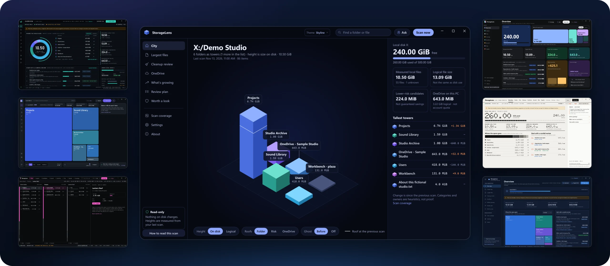</a>

You used to guess what was filling your drive and what any of it meant. StorageLens maps it, explains what each
folder is doing there, and answers your questions with AI that can run entirely on your PC.

**Read-only by design** · Reads names and sizes, never your files · AI on your PC, off until you turn it on

## One scan. Seven ways to see it.

StorageLens comes as seven apps. They read the same facts about your drives and show them in seven layouts, each
with a theme of its own. Pick the one you like, or install several: they sit side by side, and each keeps its own
scans.

<table>
<tr>
<td width="50%" valign="top">
<a href=".github/assets/layouts/standard.webp">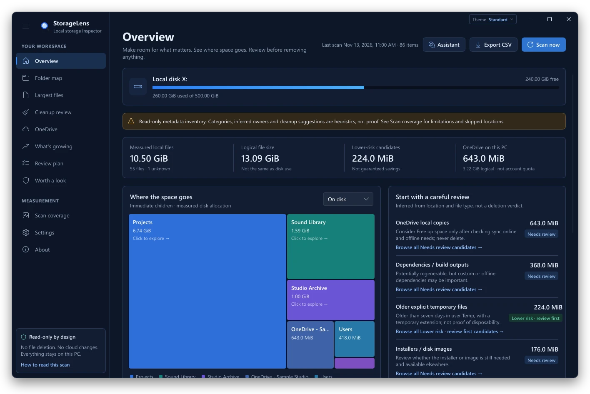</a>
<br><b>StorageLens Standard</b><br>
The original layout: a sidebar, an overview and plain lists.<br><br>
<a href="https://github.com/demar-developer/storagelens/releases/latest/download/StorageLens-Standard-Setup.exe"></a><br>
<sub>38 MB · Windows 11</sub>
</td>
<td width="50%" valign="top">
<a href=".github/assets/layouts/telemetry.webp">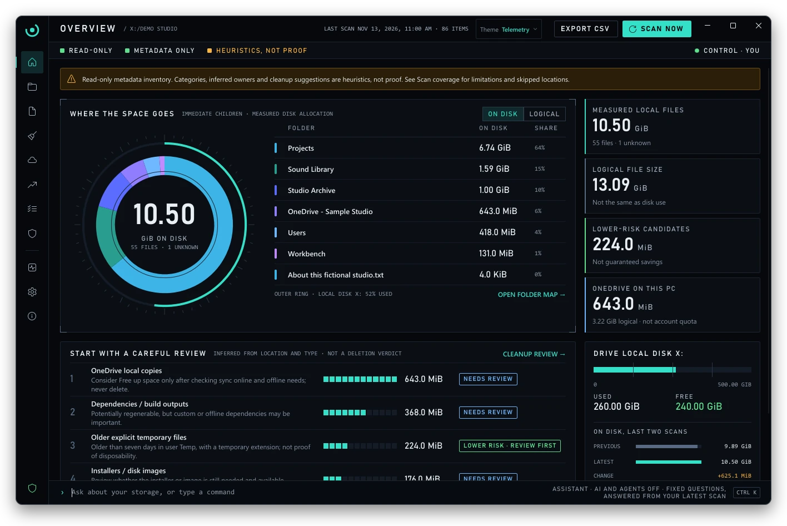</a>
<br><b>StorageLens Telemetry</b><br>
An instrument console: your drive on a dial, with readouts beside it.<br><br>
<a href="https://github.com/demar-developer/storagelens/releases/latest/download/StorageLens-Telemetry-Setup.exe"></a><br>
<sub>60 MB · Windows 11</sub>
</td>
</tr>
<tr>
<td width="50%" valign="top">
<a href=".github/assets/layouts/atlas.webp">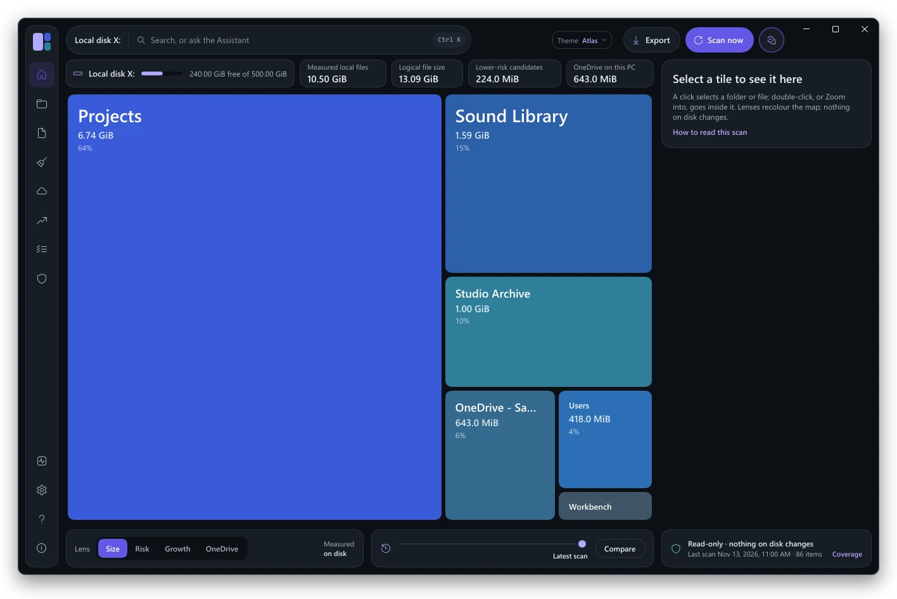</a>
<br><b>StorageLens Atlas</b><br>
A map of your drive on every page, with lenses for size, risk, growth and OneDrive.<br><br>
<a href="https://github.com/demar-developer/storagelens/releases/latest/download/StorageLens-Atlas-Setup.exe"></a><br>
<sub>63 MB · Windows 11</sub>
</td>
<td width="50%" valign="top">
<a href=".github/assets/layouts/strata.webp">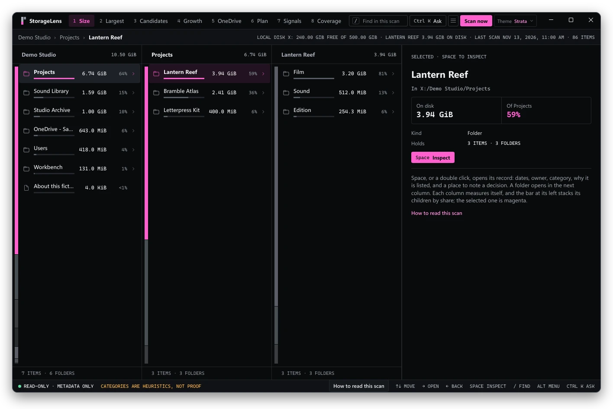</a>
<br><b>StorageLens Strata</b><br>
Your folders as columns to step through, made for the keyboard.<br><br>
<a href="https://github.com/demar-developer/storagelens/releases/latest/download/StorageLens-Strata-Setup.exe"></a><br>
<sub>58 MB · Windows 11</sub>
</td>
</tr>
<tr>
<td width="50%" valign="top">
<a href=".github/assets/layouts/mosaic.webp">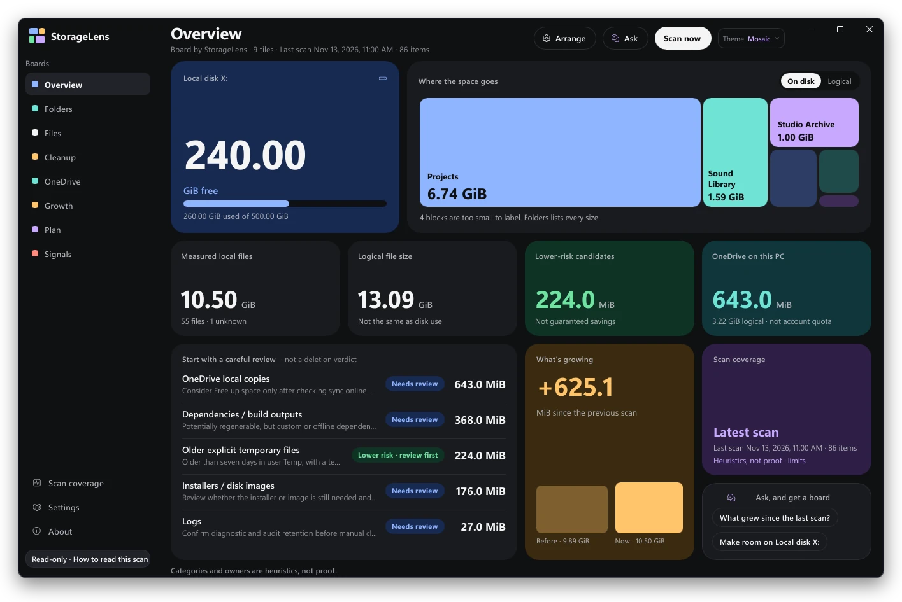</a>
<br><b>StorageLens Mosaic</b><br>
A board of tiles, each one a view of your storage.<br><br>
<a href="https://github.com/demar-developer/storagelens/releases/latest/download/StorageLens-Mosaic-Setup.exe"></a><br>
<sub>60 MB · Windows 11</sub>
</td>
<td width="50%" valign="top">
<a href=".github/assets/layouts/ledger.webp">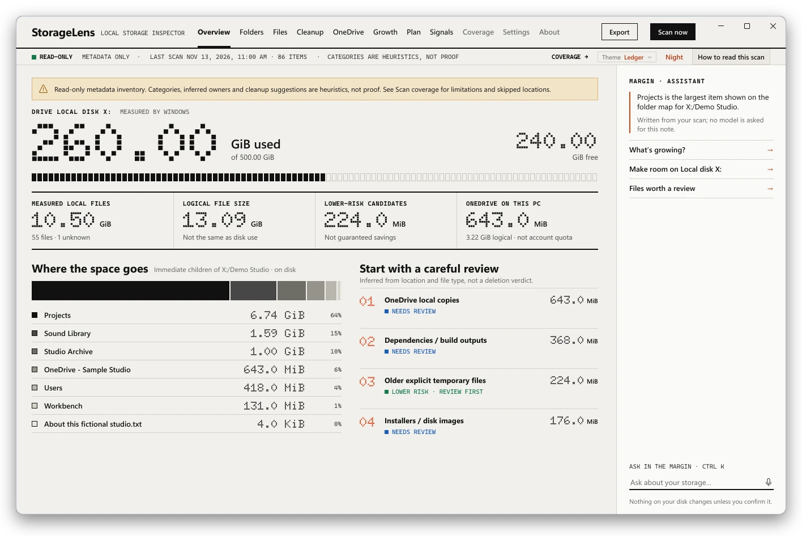</a>
<br><b>StorageLens Ledger</b><br>
Your storage as a printed report: plain figures on paper.<br><br>
<a href="https://github.com/demar-developer/storagelens/releases/latest/download/StorageLens-Ledger-Setup.exe"></a><br>
<sub>59 MB · Windows 11</sub>
</td>
</tr>
<tr>
<td width="50%" valign="top">
<a href=".github/assets/layouts/skyline.webp">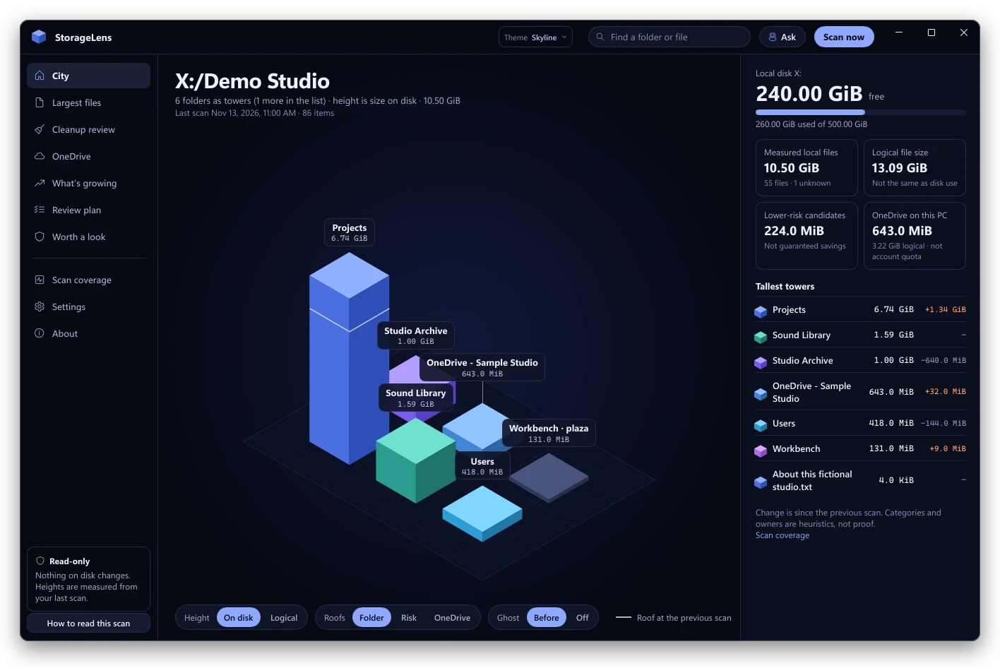</a>
<br><b>StorageLens Skyline</b><br>
Your folders as a city, the biggest standing tallest.<br><br>
<a href="https://github.com/demar-developer/storagelens/releases/latest/download/StorageLens-Skyline-Setup.exe"></a><br>
<sub>61 MB · Windows 11</sub>
</td>
<td width="50%" valign="middle" align="center">
<b>Not sure which?</b><br><br>
Start with Standard: it is the layout<br>the other six are checked against.<br><br>
You can add another later,<br>and each keeps its own scans.
</td>
</tr>
</table>

<sub>Every picture on this page was drawn by the app itself, from a made-up library. Sizes are small because the
library is.</sub>

## From a blur of files to a clear decision.

1. **Scan.** One pass over what Windows already knows about your files: names, sizes, dates and OneDrive states.
   No file is opened, and files OneDrive keeps online are never downloaded. 1.47 million items took 18 seconds on
   our own PC.[^speed]
2. **Map.** Follow the space. Every folder is a block sized by what it really takes on disk. Click one to go
   inside, as deep as you like.
3. **Understand.** For well-known Windows, developer and app folders, StorageLens says what the folder is, the
   supported way to free its space and what not to do. Everything else gets an importance level and the reason
   for it.
4. **Decide.** A plan before any action. Mark what to keep and what to review, with your own backup notes. Saving
   a decision changes StorageLens' notes and nothing on your disk.

### Every view has one job.

<table>
<tr>
<td width="50%" valign="top"><a href=".github/assets/views/folder-map.webp">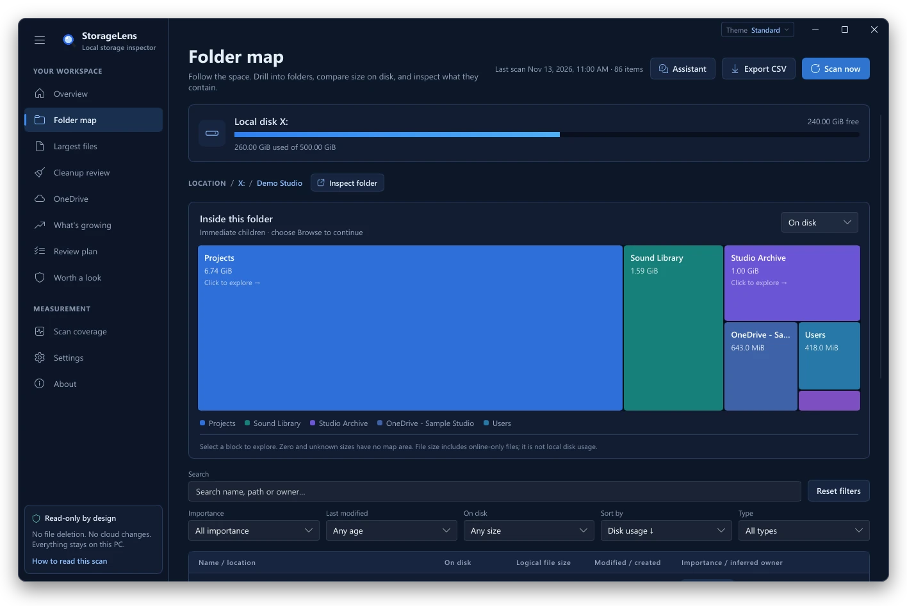</a><br><b>Folder map</b><br>Follow the space.</td>
<td width="50%" valign="top"><a href=".github/assets/views/largest-files.webp">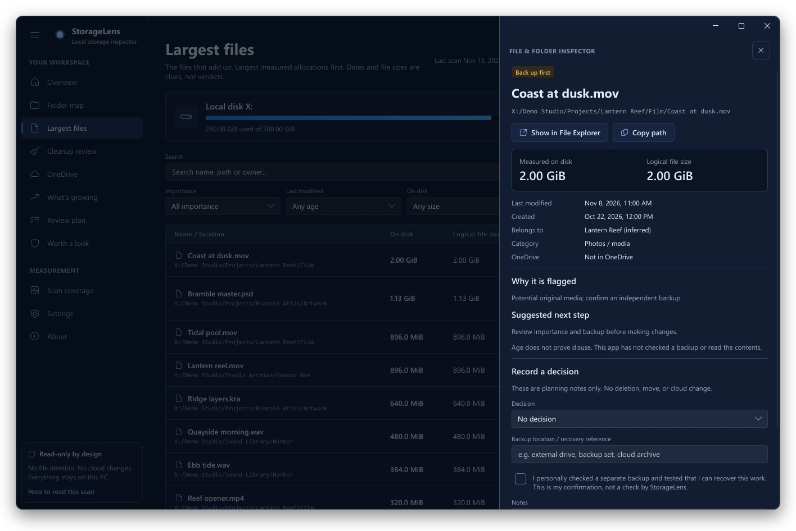</a><br><b>Largest files</b><br>The files that add up, and what each one is.</td>
</tr>
<tr>
<td width="50%" valign="top"><a href=".github/assets/views/cleanup-review.webp">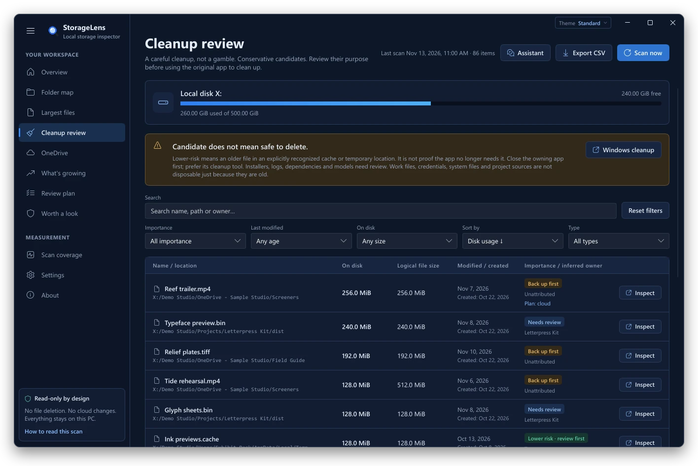</a><br><b>Cleanup review</b><br>A careful cleanup, not a gamble.</td>
<td width="50%" valign="top"><a href=".github/assets/views/whats-growing.webp">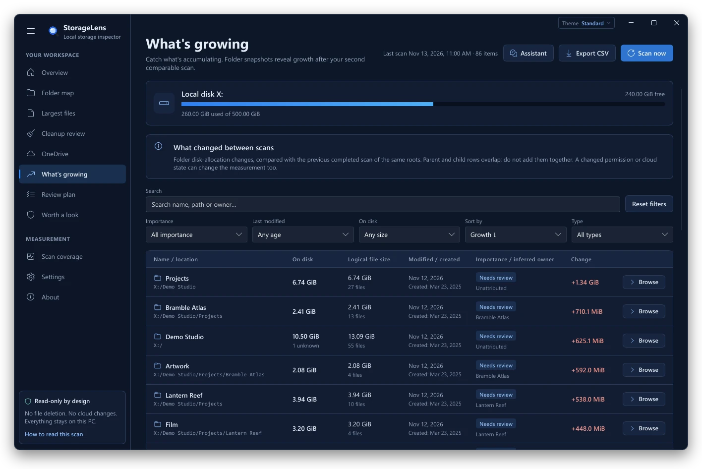</a><br><b>What's growing</b><br>Catch what's accumulating.</td>
</tr>
<tr>
<td width="50%" valign="top"><a href=".github/assets/views/onedrive.webp">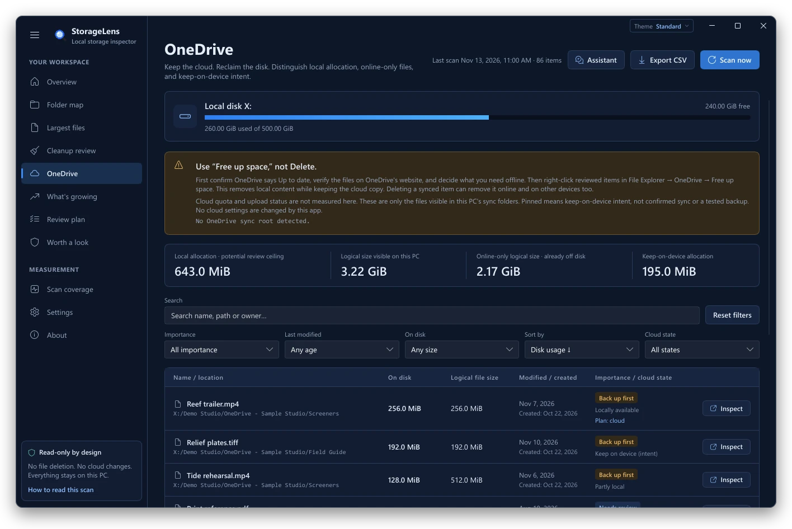</a><br><b>OneDrive</b><br>Keep the cloud. Reclaim the disk.</td>
<td width="50%" valign="top"><a href=".github/assets/views/review-plan.webp">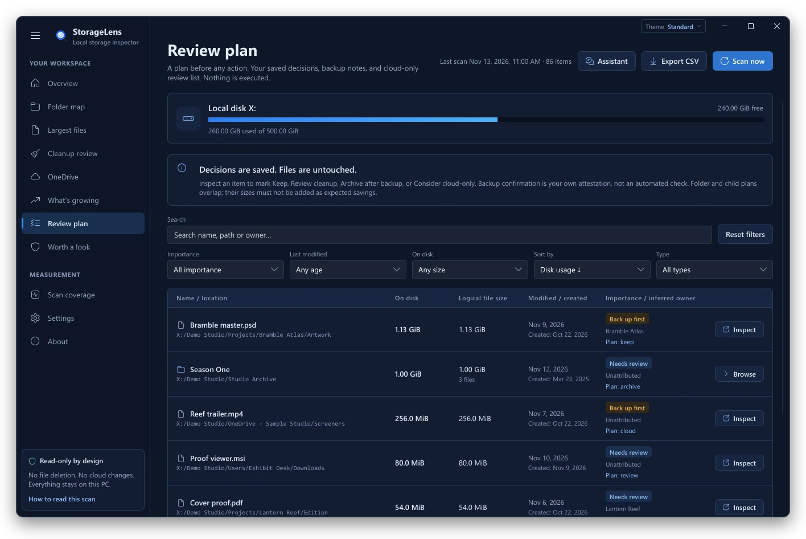</a><br><b>Review plan</b><br>A plan before any action.</td>
</tr>
</table>

<sub>Shown in the Standard layout. The other six have the same pages in their own arrangement.</sub>

## Ask in your own words. Watch the screen answer.

The Assistant doesn't hand you a paragraph to trust. It opens the right view, sets the filters and puts a page
together, and every number on that page comes from your scan, never from the AI.

<a href=".github/assets/assistant.webp">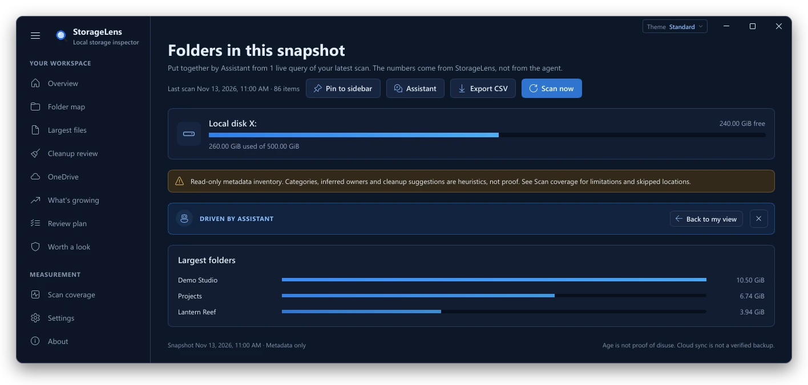</a>

- **The model picks. StorageLens counts.** A small model on your PC chooses which page answers you. The page is
  StorageLens' own, filled from the scan.
- **Other agents ask first.** Claude Desktop, Hermes and other agents can connect over MCP and read your scan.
  When one wants to move your screen, you get a card: Show me, Not now, or Always allow.
- **No AI ever acts on a file.** An agent can open views, highlight rows and build pages. It cannot delete, move,
  rename or read a file, start a scan, export, or change a setting. Those stay yours.
- **You see who is driving.** Whatever is on screen says who put it there, you, the Assistant or a named agent,
  and offers the way back.

## Measures everything, changes nothing.

<table>
<tr><td><b>Delete</b></td><td>StorageLens has no delete button anywhere.</td></tr>
<tr><td><b>Move</b></td><td>Your files stay exactly where they are.</td></tr>
<tr><td><b>Open</b></td><td>What is in a file is none of its business. It measures from names, sizes, dates and OneDrive states.</td></tr>
<tr><td><b>Download</b></td><td>Files OneDrive keeps online stay online.</td></tr>
<tr><td><b>Send</b></td><td>AI and agents are off until you turn them on. While they are off, nothing is sent anywhere.</td></tr>
</table>

Turn the Assistant on and you choose where the thinking happens: a model on this PC, or a cloud model with your
own key. With a cloud model, your question and the folder names, sizes and dates it needs go to the service you
chose. The key is kept in Windows Credential Manager.

**Look twice, change nothing.** Some files are named to fool you, and some programs sit where programs rarely
live. The "Worth a look" page points them out from names and places alone, beside what Microsoft Defender already
found. They are reasons to look, never verdicts: StorageLens is not an antivirus, and it sends you to Windows
Security to act.

## Download and install

| App | What it is | Size | |
|---|---|---|---|
| **StorageLens&nbsp;Standard** | The original layout: a sidebar, an overview and plain lists. | 38&nbsp;MB | [Download](https://github.com/demar-developer/storagelens/releases/latest/download/StorageLens-Standard-Setup.exe) |
| **StorageLens&nbsp;Telemetry** | An instrument console: your drive on a dial, with readouts beside it. | 60&nbsp;MB | [Download](https://github.com/demar-developer/storagelens/releases/latest/download/StorageLens-Telemetry-Setup.exe) |
| **StorageLens&nbsp;Atlas** | A map of your drive on every page, with lenses for size, risk, growth and OneDrive. | 63&nbsp;MB | [Download](https://github.com/demar-developer/storagelens/releases/latest/download/StorageLens-Atlas-Setup.exe) |
| **StorageLens&nbsp;Strata** | Your folders as columns to step through, made for the keyboard. | 58&nbsp;MB | [Download](https://github.com/demar-developer/storagelens/releases/latest/download/StorageLens-Strata-Setup.exe) |
| **StorageLens&nbsp;Mosaic** | A board of tiles, each one a view of your storage. | 60&nbsp;MB | [Download](https://github.com/demar-developer/storagelens/releases/latest/download/StorageLens-Mosaic-Setup.exe) |
| **StorageLens&nbsp;Ledger** | Your storage as a printed report: plain figures on paper. | 59&nbsp;MB | [Download](https://github.com/demar-developer/storagelens/releases/latest/download/StorageLens-Ledger-Setup.exe) |
| **StorageLens&nbsp;Skyline** | Your folders as a city, the biggest standing tallest. | 61&nbsp;MB | [Download](https://github.com/demar-developer/storagelens/releases/latest/download/StorageLens-Skyline-Setup.exe) |

Version 0.4.0 preview, 24 November 2026. These links always give the newest version; every version and its notes are under
[Releases](https://github.com/demar-developer/storagelens/releases).

> [!IMPORTANT]
> **Windows will ask you to confirm.** The files are not code-signed yet, so on a downloaded copy Windows shows
> "Windows protected your PC". Choose <kbd>More info</kbd>, then <kbd>Run anyway</kbd>. Your browser may also say
> the file is not commonly downloaded: choose to keep it.

<a href=".github/assets/setup.webp">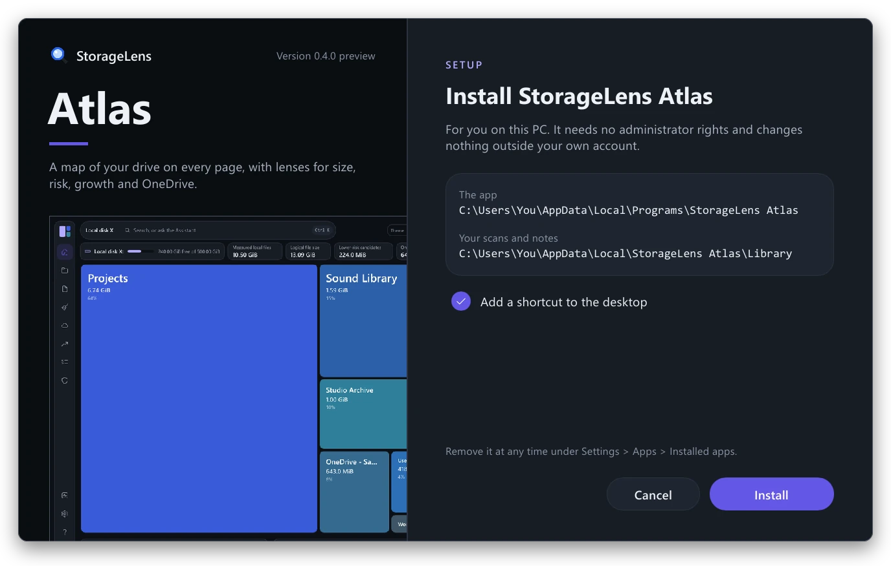</a>

1. **Open the downloaded file.** Setup wears the look of the layout you chose and shows where the app and your
   scans will go. It installs for your Windows account only and needs no administrator rights.
2. **Press <kbd>Start first scan</kbd>.** A new install starts empty. A scan reads file names and sizes only.
3. **Later:** to update, download the newer file and open it; your scans and notes stay where they are. To remove
   it, use Windows Settings > Apps > Installed apps; your scans and notes are kept until you delete that folder
   yourself.

<details>
<summary><b>Check that a download is the real one</b></summary>

<br>

[SHA256SUMS.txt](https://github.com/demar-developer/storagelens/releases/latest/download/SHA256SUMS.txt) lists the SHA-256 of every file. In PowerShell:

```powershell
Get-FileHash .\StorageLens-Atlas-Setup.exe
```

The line it prints should match the one in the list.

</details>

## Questions

<details>
<summary><b>Which layout should I pick?</b></summary>

<br>

Whichever you like looking at: the facts are the same in all seven. Standard is the layout the others are checked
against, so it is the safe first choice. You can install another later, and each keeps its own scans.

</details>

<details>
<summary><b>Will it delete or clean anything?</b></summary>

<br>

No. There is no delete, recycle, move or "Free up space" function in it. It shows you what is there, what it is
and what the supported way to free the space is, and you do the rest in Windows.

</details>

<details>
<summary><b>Does anything leave my PC?</b></summary>

<br>

Not by itself: AI and agents are off until you turn them on. If you choose a cloud model with your own key, your
question and the folder names, sizes and dates it needs go to that service. If you connect an agent of your own, it
reads what it asks for from your scan. With AI off, or with a model on your PC and no agent connected, nothing is
sent.

</details>

<details>
<summary><b>Why does Windows warn me about the download?</b></summary>

<br>

Because the files are not code-signed yet, and Windows shows that message for any new unsigned program that came
from the internet. It says nothing about what the program does. You can check a download against its checksum
(above) before you open it.

</details>

<details>
<summary><b>Where does it install, and how do I remove it?</b></summary>

<br>

In your own account, with no administrator rights: the app in `%LOCALAPPDATA%\Programs\StorageLens <Layout>` and
your scans and notes in `%LOCALAPPDATA%\StorageLens <Layout>\Library`. Remove it under Windows Settings > Apps >
Installed apps. Your scans and notes are kept; delete that folder yourself if you no longer want them.

</details>

<details>
<summary><b>Which Windows does it need?</b></summary>

<br>

It is built and tested on Windows 11, 64-bit.

</details>

## What's new, and telling us what you think

- Every change, version by version: [CHANGELOG.md](CHANGELOG.md).
- Something broken, confusing or missing? [Tell us here](https://github.com/demar-developer/storagelens/issues/new/choose). This is a preview, and that
  is what it is for.

## Licences

StorageLens is built in Rust with [Slint](https://slint.dev). The licences of the software inside the apps are in
[THIRD-PARTY-NOTICES.txt](THIRD-PARTY-NOTICES.txt), which each app's About page can save too. Ledger's figures are
set in Doto, under the SIL Open Font License, with one glyph changed: the licence and the change are in
[licenses/](licenses/).

This repository holds the downloads and their notes. The source code is not published here.

[^speed]: Measured on our own PC in November 2026, across two drives, with the file-system cache warm. Yours will
    differ.
